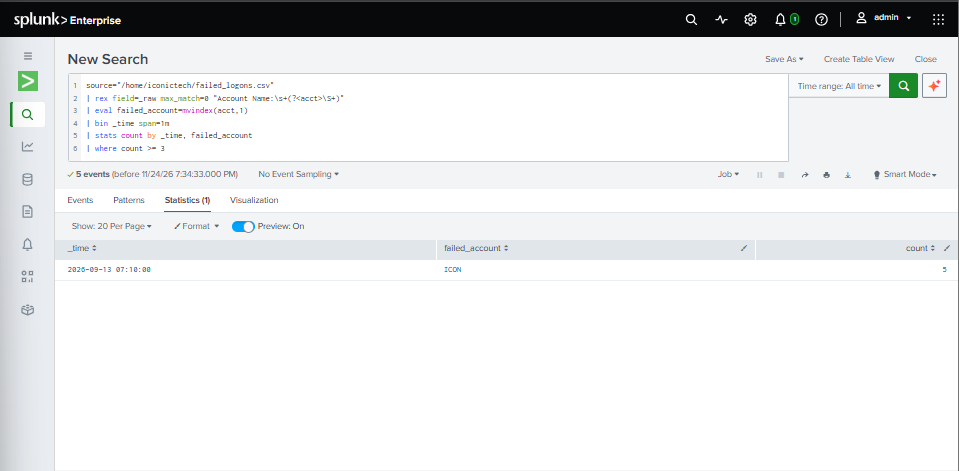
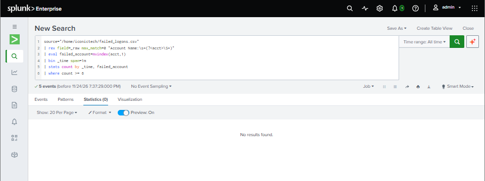

# Brute Force Detection with Splunk (Event ID 4625)

**Platform:** Splunk Enterprise (Free license)
**Environment:** WSL Ubuntu, with data exported from Windows
**Date:** 25/11/26
**MITRE ATT&CK:** T1110 Brute Force (Credential Access), closest match T1110.001 Password Guessing

## Goal
Build a detection that flags repeated failed logons, using real log data from my own machine.

## How I got the data
1. Typed a wrong password 5 times on the Windows lock screen. Each failure is logged as Event ID 4625.
2. Exported the Security log from Event Viewer as a CSV file.
3. Copied the file into WSL and imported it into Splunk (Settings, Add Data, Index Once).

All 5 events landed within 13 seconds (7:10:37 to 7:10:50 on 9/13/2026).

## The final query
```
source="/home/iconictech/failed_logons.csv"
| rex field=_raw max_match=0 "Account Name:\s+(?<acct>\S+)"
| eval failed_account=mvindex(acct,1)
| bin _time span=1m
| stats count by _time, failed_account
| where count >= 3
```

## How it works
- `rex` pulls out every "Account Name:" value. Each event has two: the computer account that reported the event, and the account that failed to log in.
- `mvindex(acct,1)` keeps the second one, the account that failed.
- `bin` groups timestamps into 1-minute buckets, so events close together can be counted together.
- `stats count by` counts failures per account per minute.
- `where count >= 3` is the threshold. It removes harmless groups, such as a single mistyped password.

## Testing it
- **Threshold 3:** the rule fired. `ICON` had 5 failures in one minute.



- **Threshold 6:** no results, because I only made 5 attempts. This showed the rule filters instead of returning everything.



## What went wrong along the way
Getting the failed account name out of the logs was the hardest part. The CSV import left each event as one block of text, so Splunk had no separate field for the account name. My first search for the exact text "Account Name:   ICON" returned 0 results, because the spacing in the raw log didn't match what I typed. My first `rex` pattern also returned nothing, even though the base search found all 5 events. I'm not certain why it failed, but I think it was because the fields sit on separate lines in the event. It worked once I captured every "Account Name:" value in the event and kept the second one.

Later I got 0 events for a search I knew should work. The time range was set to real-time instead of All time, so it ignored events that had already been indexed. After that, I checked the time range before suspecting the data or the query.

## Limitations
- It depends on the failed account being the second "Account Name" in the event. A different event format could break it.
- It ran on a one-time CSV export, not live logs. Splunk Free can't run scheduled alerts.
- The threshold (3 failures in 1 minute) is a starting guess, not a tuned value.
- It misses password spraying, where an attacker tries one password across many accounts, so each account gets only one or two failures. Catching that needs grouping by source IP, or counting distinct accounts across the environment.
- A service account with an expired password could trigger it constantly, so a real deployment would need tuning and documented exceptions.
- A failed login says nothing about intent. A forgetful user and an attacker look identical in this data.

## What I learned
Although this was self practice, I now understand why log analysis matters for a SOC analyst. The type of log I'm looking at decides the process I follow. Windows events have IDs, such as 4625 for a failed logon. MITRE ATT&CK techniques have their own separate IDs, such as T1110 for Brute Force, with sub-techniques like T1110.001 for Password Guessing and T1110.003 for Password Spraying.

## Real-world use
In a SOC, this logic would run on a schedule against live logs. An alert would go to an analyst, who would check the source, the account, and whether a successful logon (4624) followed the failures.
